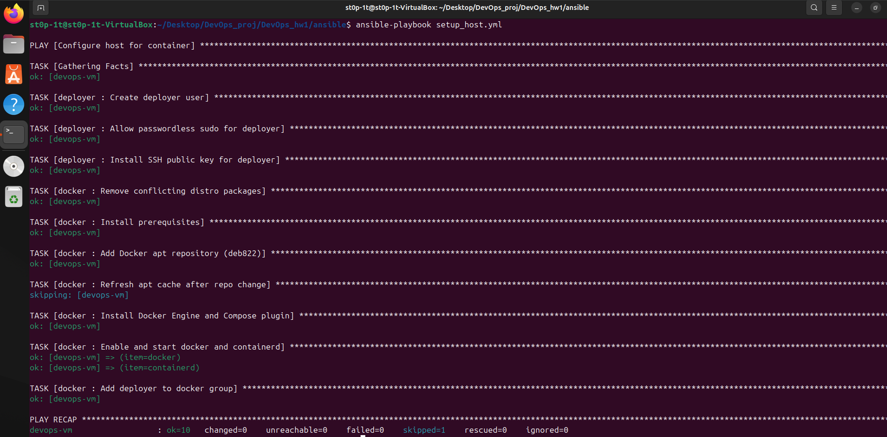
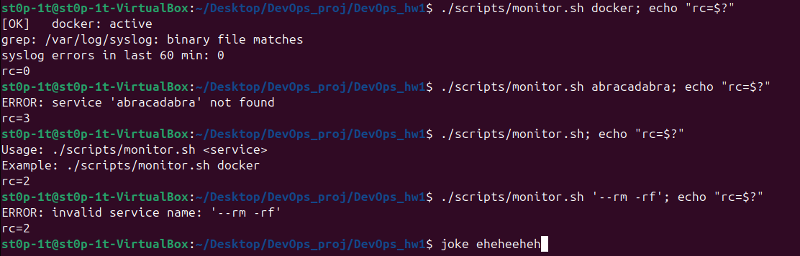
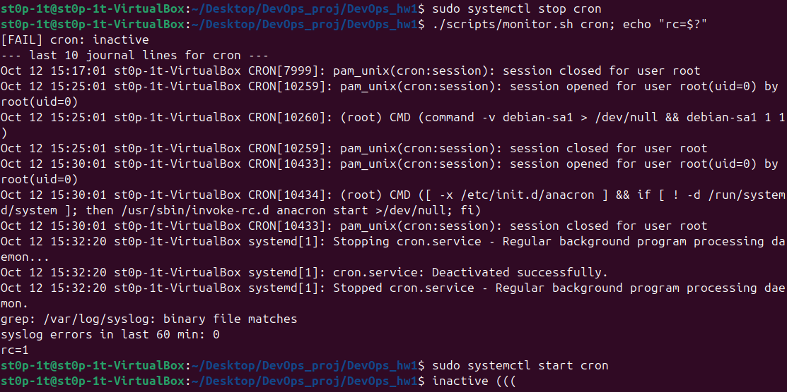
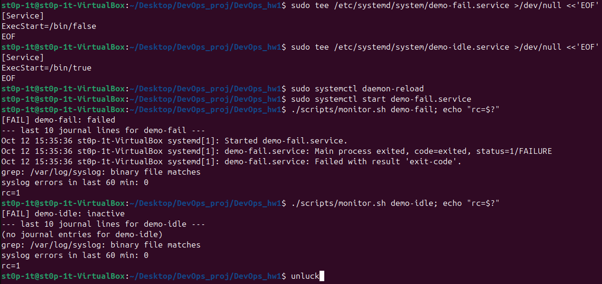
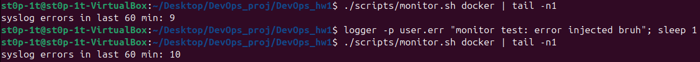
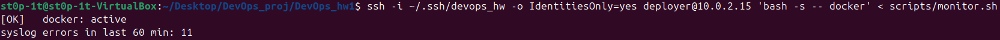
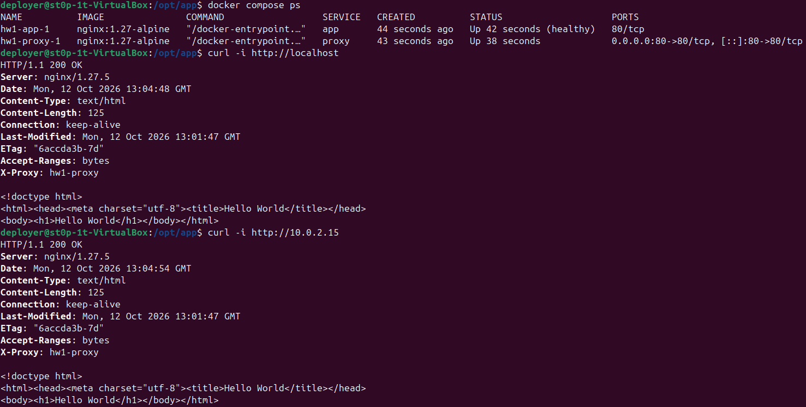
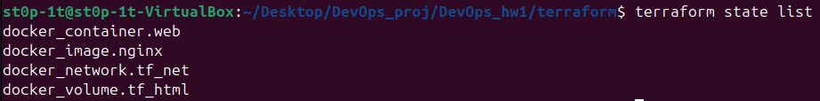

# DevOps HW1: фундамент

IaC + конфигурация + контейнеризация: Terraform, Ansible, Docker Compose, Bash-мониторинг.

## Архитектура

```
Windows host ── VirtualBox VM (Ubuntu 24.04, 10.0.2.15)
                 ├─ Ansible (роли: deployer, docker, hardening, compose_app)
                 ├─ Docker Compose, сеть hw_net:   proxy(:80) ──► app
                 ├─ Terraform,      сеть tf_net:   tf-nginx(:8080) ── volume tf_html
                 └─ scripts/monitor.sh
```

| Каталог | Назначение |
|---|---|
| `ansible/` | playbook `setup_host.yml`, inventory, роли |
| `compose/` | `docker-compose.yml`, конфиг nginx, страница app |
| `terraform/` | сеть, том и контейнер nginx через провайдер `kreuzwerker/docker` |
| `scripts/` | `monitor.sh` |
| `docs/evidence/` | скрины |

## Пререквизиты
- VirtualBox, VM Ubuntu 24.04 (x86_64), доступ в интернет, OpenSSH server
- Ansible (core ≥ 2.14), Terraform ≥ 1.5, Git
- Ключ: `ssh-keygen -t ed25519 -f ~/.ssh/devops_hw`; публичный ключ добавлен пользователю VM
- Ansible запускается с самой VM, подключается по SSH на её IP (`inventory.ini`)

## Развёртывание

1. **Ansible** (пользователь, Docker, hardening, файлы в /opt/app):
```bash
   cd ansible
   ansible-playbook setup_host.yml     # 1-й запуск (первый раз с -K, если deployer ещё нет)
   ansible-playbook setup_host.yml     # 2-й запуск: changed=0
```
2. **Compose** (на VM под deployer):
```bash
   cd /opt/app && docker compose up -d && docker compose ps
   curl -i http://<VM_IP>
```
3. **Terraform**:
```bash
   cd terraform
   terraform init && terraform plan -out=tfplan && terraform apply tfplan
   terraform state list
   curl -i http://<VM_IP>:8080
```
4. **Мониторинг**: `./scripts/monitor.sh docker`
5. Удаление Terraform-ресурсов: `terraform destroy`; compose: `docker compose down`

## Результаты

### Ansible, второй запуск (идемпотентность)


### monitor.sh






### Docker Compose и curl


### Terraform state

